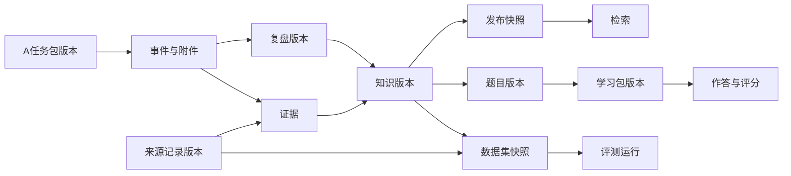

# B模块领域模型（proposed）

本文件设计关系，不创建数据库或迁移。内部主键UUID，外部ID独立字段；范围字段为org_id/project_id或经过审核的共享范围。字段名与前序任务一致，后续增加运行细节须迁移并保持合同兼容。

## 1. 所有权

A拥有项目、人员业务身份、任务、现场事件、问题整改和业务报告。B只存其版本快照与来源。B拥有知识审核发布、复盘、培训及评测。双方仅通过API或受控附件引用交换，不跨库写表。

## 2. 来源与知识

| 对象 | 主键/外键 | 唯一约束与不变量 |
|---|---|---|
| data_sources | id | namespace稳定；连接凭据不进业务JSON |
| source_documents | id，source_id→data_sources，asset_id→file_assets | 来源报告身份稳定；哈希相同不自动合并授权 |
| source_records | id，source_id，document_id，current_version | (source_id,external_record_id)唯一 |
| source_record_versions | id，record_id→source_records，batch_id→import_batches | (record_id,version)、(record_id,content_hash)唯一 |
| evidence_items | id，document_id，record_version_id，asset_id | locator和evidence_type固定到来源版本 |
| record_links | id，from_record/to_record→source_records | 同描述仅候选关联；复查、汇总和明细可关联 |
| knowledge_items | id，current_revision→knowledge_revisions | 可变入口；类型/场景/范围可查询 |
| knowledge_revisions | id，item_id→knowledge_items | (item_id,version)唯一；发布后不可变 |
| knowledge_evidence_links | revision_id，evidence_id，claim_path | 结论到证据可追溯；不只在整卡末尾附链接 |
| knowledge_releases | id | 一个激活范围只有一个活动版本 |
| release_entries | release_id，revision_id | 组合唯一；固定发布集合 |
| search_chunks | id，revision_id | 索引内容固定到知识版本和切分版本 |
| embedding_sets | id | 模型/维度/策略共同定义集合 |
| chunk_embeddings | chunk_id，embedding_set_id | 组合唯一，不混用模型向量 |

知识发布集合固定但访问权限动态检查；来源撤回后旧索引不可继续供给正文。

## 3. 任务包与复盘

| 对象 | 主键/外键 | 唯一约束与不变量 |
|---|---|---|
| task_packages | id=receipt_id，job_id→processing_runs的执行引用 | (producer,task_id,package_version)、(producer,package_id)唯一 |
| task_events | id，package_id→task_packages | (package_id,external_event_id)唯一 |
| task_package_assets | package_id，external_attachment_id，asset_id | 组合唯一，记录校验失败而非伪造可用 |
| retrospectives | id，task_package_id或固定历史来源集合 | 一次复盘输入固定到包/记录版本 |
| retrospective_revisions | id，retrospective_id | (retrospective_id,version)唯一；模板/模型/证据版本固定 |

issue和participant首版作为包内结构化快照，不复制A完整业务表。事件evidence_refs先按附件ID解析，再映射B evidence/file ID。latest_received和current_ready分开；当前ready只有处理成功后提升。

历史模式没有足够时间/事件时只做案例复盘；实际流程与建议流程分开，经验发布重新进入knowledge_revisions审核。

## 4. 培训与评测

| 对象 | 关系与约束 |
|---|---|
| training_questions→question_revisions | 题目身份与不可变发布版本分离 |
| question_revisions→knowledge_revisions/evidence_items | 答案和评分要点可追溯；生成草稿不等于审核通过 |
| learning_packages→learning_package_items→question_revisions | (package_key,version)唯一，题目顺序及版本固定 |
| training_attempts→learning_packages | 学员、时间、状态；固定学习包版本 |
| training_answers→attempts/question_revisions | (attempt_id,question_revision_id)唯一，重复提交不重复计分 |
| dataset_versions→dataset_samples | 冻结具体来源版本及标注；开发/评测按重复组隔离 |
| evaluation_runs→dataset_versions/releases | 模型配置、代码版本、参数固定 |
| evaluation_results→runs/samples | 组合唯一，失败样本也保留 |

撤回影响新使用和可见内容，但不篡改历史评分。模型评分与人工确认分开。

## 5. 公共关系

- user_links：(issuer,subject_id)唯一；role_bindings关联B角色和范围，不扩大A权限。
- file_assets存物理文件信息，来源授权不能仅靠文件哈希决定。
- review_actions固定object_type/object_id/object_version，服务层维护类型注册和对象存在性；批准旧版本不能批准新内容。
- audit_events记录操作而非完整敏感正文。
- processing_runs关联业务对象和队列job_id；队列内部表由成熟组件维护。
- 幂等映射在B01/B05以事务表或等效持久机制实现，作用域和存续期见semantics；不靠内存缓存。

## 6. 关系图

