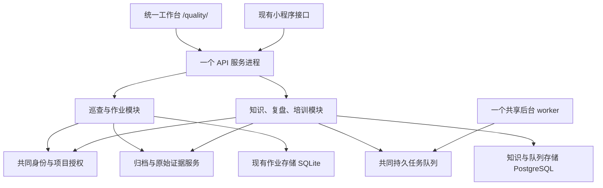

# 质量安全小察 A/B 融合开发方案与验收记录

## 交付状态

2026-10-29：本轮五个开发阶段已完成本地实现和对应验收。统一网页、单一 API 服务、共享身份和项目范围、归档复盘、已发布知识查询及培训闭环已经贯通。生产上线没有执行，线上老平台认证及真实云模型效果不属于本次本地通过结论。

用户已确认“目前数据库里没有数据，所以不需要迁移数据”。因此取消历史业务数据搬迁和数量对账；保留空库建表、数据库版本升级及隔离数据演练。不要再把真实数据副本作为开发阻塞条件。

代码基线：GitHub `kaipingjin1130-collab/Weixin-Mini-Program` 的 `ABversion` 分支，提交 `a798237250c219af7061c26fc247d580f5e5ca19`。初始工作区无用户未提交改动。本次修改保存在当前检出目录，未推送、未部署生产。

## 1. 学习结果与融合决策

### 原有边界

| 业务/能力 | 原实现 | 本次处理 |
| --- | --- | --- |
| 巡查、报告、小程序及任务 | `platform-module/candidate/server.py`、`workflow.py`，SQLite | 保留业务规则和原接口合同，纳入统一 API 进程 |
| 网页工作台和任务页 | `web/app.js`、`work.js`，任务页单独加载 | 统一导航，任务页改为可挂载、可卸载模块 |
| 知识、复盘及培训 | `b-risk-knowledge/backend`，FastAPI、PostgreSQL、持久队列；React 网页 | 前端作为业务内容挂载；后端合并进同一 API 进程 |
| 账号及项目授权 | 老平台身份适配、A 会话和项目成员 | 继续作为唯一权限来源，B 不另设登录、不扩大授权 |
| 归档、证据和版本 | 已有网关、映射器、附件哈希及来源检查 | 复用并接到页面操作，贯通固定归档版本至复盘 |
| 作业知识查询 | 独立适配器，存在演示回退 | 改查共用的已发布知识服务；失败返回明确错误 |

### 最终架构



一个 API 进程由 `platform-module/fusion_app.py` 承载；既有 A 处理器通过适配层接入，B 的 FastAPI 应用在同一进程内运行。后台耗时任务由独立 worker 处理，这属于同一套平台服务的后台执行部分。旧的独立 B API 进程在本地验收时已停止。

保留 SQLite 与 PostgreSQL 两种内部存储，不声称已经合为同一种数据库。保留现有存储是为避免无业务收益地重写作业事务和小程序同步规则；两种存储均处于统一平台服务之后。用户取消的是历史数据迁移。

前端沿用 A 外壳，把 React 业务组件与原生任务模块纳入同一导航和生命周期，不整页重写已验证的报表、签名和离线业务。B 内容用 Shadow DOM 隔离样式，并复用工作台的绿色、字体及卡片样式。此方案满足统一使用体验，不以全量改写成 React 作为完成标准。

## 2. 分阶段实施与验收

| 阶段 | 实现内容 | 通过依据 | 状态 |
| --- | --- | --- | --- |
| 1：基线和环境 | 下载分支；确认接口、身份、业务表、证据、部署和测试边界；专用测试数据库 | Git 基线、依赖及原有回归检查；隔离容器和存储核对 | 完成 |
| 2：统一网页 | 一套导航；A 任务页和 B 各模块在当前工作台加载；深链接、返回前进、项目选择持久化、离开提醒、登录失效回到统一登录 | 类型检查、双入口构建、路由测试；1440px 桌面与 390px 手机浏览器实测 | 完成 |
| 3：共享入口和归档闭环 | 合并 API 进程；共享会话；归档页生成/打开复盘；保留幂等、版本、证据校验和实时权限 | 实际 HTTP、数据库及 worker 跑通归档复盘；重复请求、越权、撤权、退出、并发及附件下载通过 | 完成 |
| 4：知识和培训 | 作业查询调用已发布知识；复盘审核转知识草稿，再审核发布、生成题目、发布学习包及作答；引用、发布版本和人工确认提示 | 完整业务链通过；缺少知识返回证据不足；来源补正后复盘和查询失效；回归覆盖失败、版本和权限 | 完成 |
| 5：公共能力和交付 | 共用后台队列、模型设置入口、成果证据和汇总审计页面；统一启动、环境模板与服务定义；取消历史数据迁移 | 平台服务页面读取真实 worker 和审计记录；统一服务持续运行；构建、语法、差异检查通过 | 完成 |

阶段内发现问题先修复再继续；跨阶段公共改动最后对受影响路径复验。不能把以下本地通过记录解释为生产上线验收。

## 3. 具体实现与接口约束

### 统一网页

导航按用户确认的结构分组，原页面全部保留：

- 工程风险管理：工作台（任务管理）、一键上报、整改复核、报告中心（成果归档、历史资料、成果接入）。
- 知识管理：风险数据（知识库与检索、知识加工与审核）、案例复盘、培训学习。
- 个人中心：个人中心、项目管理、平台服务。

桌面侧栏使用可展开分组；手机底部保留三个主入口，次级菜单向上展开，点击页面后收起。历史资料与风险数据分别定位原来源页面和原记录页面。导航完整性及报告回归 7 项通过；浏览器验证了页面切换、桌面分组及 390px 手机菜单，手机无横向溢出。

- 主入口：`/quality/`；任务：`#/work?module=tasks`；知识：`#/b/knowledge/library`。
- 历史 `/quality/work?...` 地址带原任务参数进入统一任务页面；`/quality/b/#/...` 旧书签进入统一工作台对应页面。
- 顶部项目选择同时约束工作台报告、任务、知识、复盘、培训及后台任务。B 请求携带 `X-Project-ID`，后端收窄实时授权；伪造未授权项目返回 403。完整授权在身份持久化之后才收窄，避免界面筛选影响已排队任务的身份。
- 模块离开时卸载组件和定时器；异步响应不得把已经离开的页面重新挂回。
- 侧栏跳转和项目切换存在未保存提醒；浏览器后退/前进正常切换任务和知识页；登录失效卸载业务页并回到统一登录。
- `ArchiveReview.tsx` 复用归档接入幂等键，显示证据处理状态，成功后打开同一份复盘；失败或仍在处理时提供成果清单入口。

### 单一 API 服务

- `run_platform.py api` 启动一个 API 进程，监听本机地址，由现有反向代理提供 HTTPS。
- `fusion_app.py` 复用 A 的处理器、返回头、Cookie、JSON、下载文件和事务行为，不复制核心业务规则。
- `/__knowledge/` 是进程内知识应用路由，仅本机来源与正确服务密钥可进入；浏览器直接访问被拒绝。服务启动禁用转发 IP 信任。
- A 普通请求与身份回调使用不同的有界线程池，避免请求等待知识服务时耗尽身份回调线程。20 个并发身份请求已验证完成。
- 接口继续使用 `/quality/api/...` 和 `/quality/b/api/v1/...` 两组兼容路径，但由同一进程处理；保留路径并不代表仍运行两个系统。
- A 会话目前保存在内存中，API 只运行一个进程；重启后需重新登录。不要直接增加多进程 API worker。

### 知识与来源

- `/api/work/knowledge` 先检查任务项目权限、读取任务快照，再释放 SQLite 连接后调用共用知识服务；不在持有写锁时进行回调。
- 仅使用已审核且已发布的知识，并返回发布版本、引用、适用性警告和人工确认要求。服务失败不替换成演示答案。
- 普通巡查场景的 `generic` 和 `general_inspection` 为已有合同中的同义编码；其他场景不自动归并。
- 未分类检查对象不会被当成一个实际知识类别；页面明确要求人工确认适用条件。
- 已发布复盘经验接入同一来源可用性检查。原成果补正、撤回或被新版本替代后，复盘、知识及培训来源继续接受实时校验。
- 当前归档映射支持 `inspection` 巡查场景。原 A 的其他场景可以继续作业，但不会被臆测为巡查并生成复盘。

### 公共能力

- 文件：原始作业证据由 A 保管，知识侧保存固定归档引用及经过大小、归属和哈希校验的处理结果；不通过路径直读绕开权限。
- 任务：资料接入、归档处理、知识索引等复用现有持久队列和一个 worker，统一页面可查看状态及重试。
- 审计：平台服务页汇总当前项目范围内的作业事件和知识操作；详细原始记录继续留在对应业务成果中。
- 模型：统一入口进入已有模型配置，作业知识查询不再维护另一套模型适配和演示回退。本次没有配置或调用付费云模型。

## 4. 实际验收证据

### 自动检查

| 检查 | 最终结果 | 范围 |
| --- | --- | --- |
| B 后端回归 `tools/check.py` | 99 passed，131.99 秒 | 身份、权限、资料、复盘、知识、检索、培训、队列等；含 3 项新增项目范围检查 |
| 网关及查询桥接 pytest | 16 passed | 原网关 10 项；新桥接 6 项，含断连、超时、403、重定向、合同和来源版本 |
| Node 报告目录 | 6 passed | 报告聚合、旧下载链接和深链接导航归属 |
| 小程序离线逻辑 | 10 passed | 草稿、照片、重试、授权及防重复 |
| 小程序实际 HTTP 同步 | 1 passed | 同步后网页可见，重复同步不重复建档 |
| 网页传输和路由脚本 | 两组通过 | 同源、CSRF、去除演示令牌、项目上下文、嵌入路由 |
| TypeScript、Vite 独立及嵌入构建 | 通过 | 最终资源已同步到 `platform-module/b-web` |
| Python 语法与 `git diff --check` | 通过 | 入口、适配、查询桥接、构建、验收工具；无补丁空白错误 |

保留两个上游依赖弃用提示：Starlette/httpx 和 jieba/pkg_resources；没有因此替换依赖或把警告当作失败。Git 的换行提示不属于补丁错误。

### 实际服务闭环：9 组通过

可复跑脚本：`platform-module/tools/accept_fusion.py`。最新明细保存在本机 `.local/fusion-integration/acceptance.json`，不包含登录令牌和服务密钥。

1. 统一入口、共享身份、内部路由拒绝和写入校验。
2. 20 个并发身份回调完成，无死锁。
3. 项目选择收窄、越权拒绝、管理角色降为普通角色后立即失去加工权限。
4. 建项目、临时巡查、签名证据、现场上报、接收、正式成果、最终归档与 ZIP 下载。
5. 接入归档、证据处理、生成复盘；接入及复盘重复操作复用既有结果。
6. 测试人员核对复盘条目、提交审核、批准、转知识、再审核发布；作业查询返回发布版本和引用。
7. 从已发布知识生成题目并审核，发布学习包；普通成员只能看到试题而非标准答案，并可保存和提交作答。
8. 原成果补正后，旧复盘及知识不可继续使用；作业查询返回证据不足。
9. 统一退出后旧会话访问知识接口返回 401。

此测试使用真实业务代码、独立 PostgreSQL、SQLite、HTTP 和后台 worker。只有老平台身份响应使用明确标注的本地测试身份；不能据此声称线上 PHP 认证已经联调通过。测试中的审核动作只针对隔离样例，不是实际工程结论。

### 浏览器检查

- 桌面 1440×1000、手机 390×844：查看统一任务列表、知识库及运行页面，文字、卡片和导航可读；手机页面宽度 390，无文档横向溢出。
- 最终桌面与手机截图保存在 `.local/fusion-integration/desktop-final.png` 和 `mobile-final.png`。
- 七个知识/平台菜单依次切换，均保持一个外侧导航；切回任务页正常。
- 归档页面“生成 / 打开复盘”实际进入既有复盘详情。
- 旧 B 地址与旧任务地址进入统一工作台，并保留任务定位。
- 项目选择经过刷新仍保留；平台服务页按该项目显示真实后台在线状态和操作记录。
- 离开未保存任务时点击取消，页面及输入保留；历史后退取消分支通过浏览器注入确认返回值检查；正常后退及前进经过真实导航验证。
- 知识页会话失效后回到统一登录页，旧内容卸载。
- 早期发现嵌入构建残留 `process.env`、错误状态同时显示空数据、历史资料详情菜单归属、任务哈希被部署前缀改写等问题，均修复后复验。

## 5. 构建、启动与部署方法

### 网页构建

在仓库根目录，使用已有 Python 和 Node/npm：

```text
python platform-module/build_frontend.py
```

首次尚未安装前端依赖时可显式增加 `--install`，按锁文件执行 npm ci。脚本完成类型检查、独立入口及嵌入构建后同步部署资源；日常构建不隐式安装依赖。

### 平台运行

按 `platform-module/deployment/fusion.env.example` 配置环境变量；密钥及数据库密码放在仓库外的受保护环境文件，不写入 Git。

```text
python platform-module/run_platform.py init
python platform-module/run_platform.py api
python platform-module/run_platform.py worker
```

`api` 和 `worker` 分别作为常驻进程启动。`init` 初始化空库和现有数据库结构版本，不导入业务数据，也不在真实身份模式中写入演示身份。部署环境需要 PostgreSQL 的 vector 扩展及 B 已锁定的 Python 依赖。

服务文件已提供：

- `platform-module/deployment/qaxc-platform-api.service`
- `platform-module/deployment/qaxc-platform-worker.service`

两者读取同一 `/etc/qaxc-platform.env`。模板使用 `/opt/qaxc-ab` 和 `/var/lib/qaxc-platform`；实际安装时按目标主机核对路径及服务账户。默认同一 API 端口 18765，网页前缀 `/quality`，内部回调地址由统一启动器推导；不应沿用旧的独立 B API 地址。启用新服务前停止占用同一端口的旧服务，保留原 HTTPS 反向代理路径。

旧 `deploy_ab.py` 为兼容旧双进程部署保留，不把它当作本次统一服务的新安装入口。它同步文件的清单已补齐，避免遗漏任务脚本和公共样式。

### 本机复验

推荐双击仓库根目录的 `打开ABversion.cmd`。启动器通过 `open_fusion.ps1` 读取现有虚拟环境的 `pyvenv.cfg`，使用其指向的已安装 Python，并复用原 `Lib/site-packages` 依赖；没有重装环境或修改系统权限。本机虚拟环境启动程序会令子进程以低完整性运行，直接调用它会导致 Docker 命名管道访问被拒绝，因此启动器不再使用该启动程序。开发测试服务固定 127.0.0.1:18771；数据库容器 `qaxc-fusion-test-postgres` 使用 55447 端口，未使用原 B01 数据库。

启动器已实际验证：网页和 worker 未运行时自动启动、重复打开复用相同进程、使用独立浏览器配置打开网页。 本地 HTTP 测试入口使用独立的 HttpOnly 会话 Cookie，生产入口仍保留 Secure 设置；已验证不携带 Bearer 令牌也能登录并访问工作台、任务和知识接口，退出后接口拒绝旧会话。`--check` 只校验配置，`--no-browser` 启动并检查服务但不打开浏览器。关闭 CMD 窗口不停止服务；不停止、替换或重启其他联调服务。下列命令用于手动复验，需使用相同的 Python 和项目依赖环境。

```text
python platform-module/tools/fusion_test_database.py
python platform-module/tools/fusion_runtime.py init
python platform-module/tools/fusion_runtime.py unified
python platform-module/tools/fusion_runtime.py worker
python platform-module/tools/accept_fusion.py
```

常驻命令分开运行。本地测试启动器打开网页时自动建立管理员会话，无需输入账号密码；退出后重新打开或刷新会再次自动进入。显式登录普通测试成员后，模块切换保留该成员身份。正式部署入口没有启用免登录。保留手动测试登录：账号 `fusion` 或 `fusion-member`，密码 `fusion-test-only`，只对隔离测试启动器有效。测试项目、附件及密钥位于忽略的 `.local` 目录，不能复制为生产数据或生产身份实现。

## 6. 本轮完成范围与上线边界

- 本轮开发和本地验收已完成；历史数据迁移按用户确认取消。
- 已形成单一网页工作台和单一 API 进程，共享身份、项目范围、后台任务、知识服务与操作记录入口；内部仍保留两种存储。
- 线上老平台认证、目标主机服务切换、反向代理切换及生产验收尚未执行，不能用本地测试身份结果代替。
- 摘要、题目候选和特征哈希检索仍按已有实现明确标注为本地模板/模拟模型；尚未验证真实云模型准确性。人工审核与来源校验继续有效。
- 非巡查归档映射、分布式会话、多 API 进程扩容属于后续能力，不冒充已经具备。
- 未发送外部消息，未提交或推送 Git，未修改生产系统。
